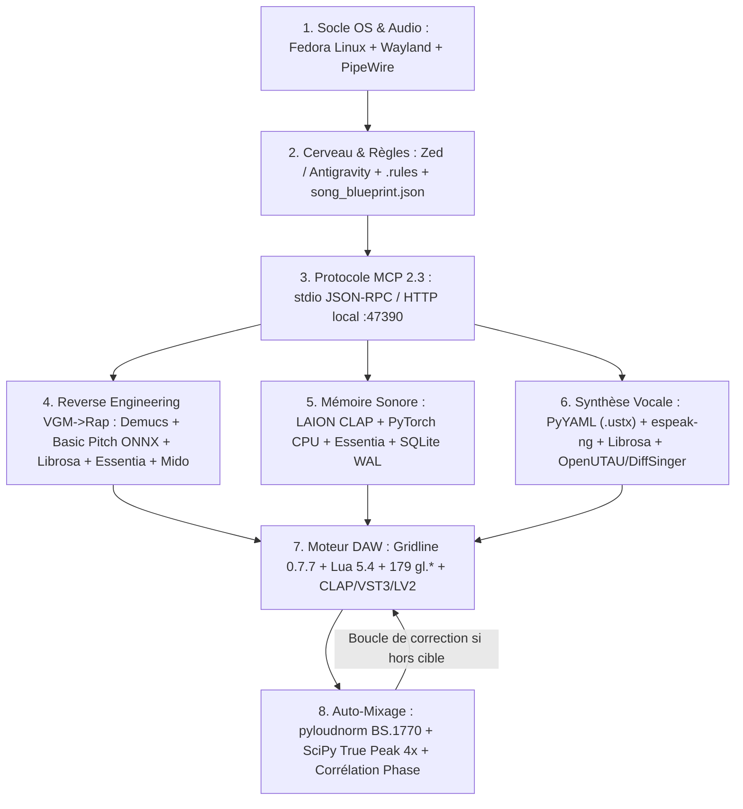

# Technologies Employées, Ordre d'Exécution et Rôle dans le Projet

Ce document présente **l'ensemble de la pile technologique** utilisée dans ce studio de production musicale assistée par IA sur **Fedora / Ultramarine Linux**, classée **dans l'ordre chronologique et architectural exact** dans lequel chaque brique intervient entre le matériel audio et le morceau final.

---

## 1. Vue d'ensemble : Chaîne et Ordre des Technologies

---

## 2. Détail des Technologies dans l'Ordre d'Intervention

### Couche 1 — Socle Système & Audio Temps Réel
Intervient **en permanence tout en bas de la pile** pour transporter l'audio et afficher les interfaces graphiques sans décrochage.

| Ordre | Technologie | Rôle exact dans le projet |
| :--- | :--- | :--- |
| **1.1** | **Fedora / Ultramarine Linux (`x86_64`)** | Système d'exploitation hôte fournissant `glibc`, les pilotes matériels et le gestionnaire de paquets `dnf` utilisé par [`install.sh`](../install.sh). |
| **1.2** | **Wayland / XWayland** | Serveur d'affichage natif pour les interfaces graphiques (Gridline, Zed, Antigravity, OpenUTAU, plugins CLAP/VST3). |
| **1.3** | **PipeWire + `pipewire-pulse` + `pipewire-jack`** | Moteur audio multimédia unifié du système. Remplace PulseAudio et JACK sans configuration manuelle complexe afin de faire cohabiter Gridline, les plugins temps réel et l'écoute système à faible latence. |

---

### Couche 2 — Interface Humaine, Cerveau IA & Gouvernance
C'est le **point d'entrée de tout workflow** : avant de poser la moindre note, l'agent lit les règles du projet et établit un contrat musical structuré.

| Ordre | Technologie | Rôle exact dans le projet |
| :--- | :--- | :--- |
| **2.1** | **Antigravity IDE & Zed IDE** | Postes de travail de l'utilisateur. Zed (`context_servers`) et Antigravity (`mcpServers`) hébergent la conversation IA et lancent les serveurs MCP locaux. |
| **2.2** | **Modèles IA (Gemini / Modèles locaux)** | Rôle de compositeur, arrangeur et ingénieur du son : interprète le prompt, planifie, appelle les outils MCP et itère sur les résultats chiffrés. |
| **2.3** | **Fichiers de règles (`.rules`, `GEMINI.md`, `AGENTS.md`)** | Imposent la discipline musicale (blueprint obligatoire, séparation fréquentielle, syntaxe Lua `function apply()`, boucle d'auto-mixage) et empêchent l'IA d'improviser des appels invalides. |
| **2.4** | **JSON Schema (`jsonschema`) & `song_blueprint.json`** | Contrat formel validé contre [`schemas/song_blueprint.schema.json`](../schemas/song_blueprint.schema.json) : fige le BPM, la tonalité, la cible LUFS, la structure par mesures, le plan de fréquences et les pistes avant génération. |

---

### Couche 3 — Couche de Transport & Interconnexion
Relie le raisonnement textuel de l'IA aux logiciels audio réels.

| Ordre | Technologie | Rôle exact dans le projet |
| :--- | :--- | :--- |
| **3.1** | **MCP (`mcp` v2.3 `MCPServer`) via JSON-RPC `stdio`** | Protocole standardisé permettant à Antigravity et Zed de découvrir les outils (`tools/list`) et d'exécuter des actions atomiques sur les 5 serveurs spécialisés. |
| **3.2** | **Pont intelligent [`scripts/gridline-mcp.sh`](../scripts/gridline-mcp.sh) + HTTP local `:47390`** | Détecte automatiquement si Gridline GUI écoute sur le port `47390` pour s'attacher en direct (`--attach`), ou bascule sans erreur sur le mode fichier headless (`gridline mcp <projet.gridline>`). |

---

### Couche 4 — Reverse Engineering VGM → Rap (`reverse-engineer`)
Intervient **en amont de la composition** lorsqu'on part d'un morceau existant (classique de jeu vidéo, boucle, sample).

| Ordre | Technologie | Rôle exact dans le projet |
| :--- | :--- | :--- |
| **4.1** | **Meta Hybrid Transformer Demucs (`htdemucs` / `htdemucs_6s`) via `gridline stems`** | Sépare un mix complet en 4 ou **6 stems isolés** (`drums`, `bass`, `other`, `vocals`, `guitar`, `piano`) en local sur CPU AVX2. |
| **4.2** | **Essentia (`KeyExtractor`) & Librosa (`beat_track`, `chroma_cqt`)** | Extrait le BPM source (et ses multiples demi/double-temps), la tonalité musicale et la grille d'accords mesure par mesure pour préparer le flip Rap (`analyze_song_for_rap_flip`). |
| **4.3** | **Spotify Basic Pitch ONNX (`tools/models/nmp.onnx`) via `onnxruntime`** | Réseau neuronal polyphonique Audio→MIDI exécuté directement en Python sans TensorFlow : convertit un stem mélodique ou harmonique en notes MIDI quantifiées prêtes pour `set_notes`. |
| **4.4** | **`mido`** | Écrit des fichiers `.mid` standards à partir des notes transcrites pour archivage ou ré-import dans n'importe quel DAW. |

---

### Couche 5 — Mémoire Sonore & Sélection de Samples (`audio-index`)
Intervient **juste après le blueprint** pour alimenter le DAW avec les bons one-shots, 808 et boucles de ta banque locale.

| Ordre | Technologie | Rôle exact dans le projet |
| :--- | :--- | :--- |
| **5.1** | **SoundFile (`libsndfile`) & `ffmpeg`** | Décode rapidement les formats `.wav`, `.ogg`, `.flac`, `.mp3` lors de l'indexation. |
| **5.2** | **Essentia (`SpectralCentroidTime`, `KeyExtractor`) & Librosa** | Mesure objectivement chaque sample : tonalité, BPM, brillance spectrale (bande `sub` à `air`), attaque (`punchy` vs `sustained`) et classification boucle/one-shot. |
| **5.3** | **LAION CLAP (`laion/clap-htsat-unfused`) via PyTorch CPU + HuggingFace Transformers** | Encode chaque son et chaque requête textuelle dans un espace vectoriel commun à 512 dimensions pour la recherche sémantique (*« kick sec punchy »*, *« pad sombre »*). |
| **5.4** | **SQLite (mode WAL)** | Base locale légère [`samples.db`](../mcp-servers/audio-index/samples.db) stockant métadonnées musicales, tags et vecteurs CLAP `float32` pour répondre en quelques millisecondes. |

---

### Couche 6 — Synthèse Vocale & Chant (`vocaloid`)
Intervient **lorsque le blueprint prévoit du chant, des refrains ou des textures vocoder**.

| Ordre | Technologie | Rôle exact dans le projet |
| :--- | :--- | :--- |
| **6.1** | **Syllabateur FR/EN + `PyYAML` (`.ustx`)** | Découpe les paroles en syllabes chantables et génère des projets OpenUTAU YAML (`ustx_version: 0.6`, 480 PPQ) alignés sur la grille et la mélodie. |
| **6.2** | **`espeak-ng` + Librosa (`yin`, `pitch_shift`, `time_stretch`)** | Synthétise immédiatement un guide vocal chanté `.wav` transposé sur chaque note MIDI et calé sur le BPM, exploitable directement dans Gridline (`gl.vocoder` Cipher, `gl.pitcher` Plumb). |
| **6.3** | **OpenUTAU (`0.1.576` Avalonia / .NET) + DiffSinger** | Éditeur vocal neuronal installé dans `tools/OpenUtau/` pour rendre des voix chantées réalistes lorsque des banques DiffSinger sont ajoutées dans `voicebanks/`. |

---

### Couche 7 — Station Audionumérique, Scripting & Sound Design (`gridline`)
C'est le **cœur de fabrication sonore** qui assemble toutes les pistes, motifs rythmiques, effets et automatisations.

| Ordre | Technologie | Rôle exact dans le projet |
| :--- | :--- | :--- |
| **7.1** | **Gridline `0.7.7`** | DAW Linux natif orienté patterns et playlist, avec serveur MCP intégré, historique d'annulation isolé (`AI: ...`), import/export `.flp` (FL Studio) et rendu audio offline. |
| **7.2** | **Moteur Lua `5.4` sandboxé** | Exécute des scripts algorithmiques dans Gridline (`function apply()`) pour générer accords, arpèges, rolls de hi-hats, humanisation et routage automatique de bus mixeur. |
| **7.3** | **179 plugins natifs `gl.*`** | Base sonore 100 % fiable en mode headless comme en live : `gl.sampler`, `gl.seltmann` (chopper), `gl.plasma`, `gl.matrixfm` (Lattice), `gl.analog`, `gl.keys`, `gl.eq`, `gl.comp`, `gl.limiter`, `gl.hall`, `gl.vocoder`, `gl.pitcher`. |
| **7.4** | **Plugins tiers Linux natifs (`CLAP` / `VST3` / `LV2`)** | **Surge XT** (synthé hybride), **ZL Equalizer 2** (EQ dynamique + FFT), **TDR Nova** (EQ dynamique 4 bandes), **CHOWTapeModel** (saturation bande/lo-fi), **Dragonfly Reverb** (Hall/Room/Plate/ER) et **LSP Plugins** (Spectrum Analyzer, Oscilloscope, Crossover, Compressors). |

---

### Couche 8 — Auto-Mixage Mathématique & Validation (`audio-analyzer`)
Intervient **en fin de chaîne avant livraison** pour vérifier et corriger objectivement le rendu audio.

| Ordre | Technologie | Rôle exact dans le projet |
| :--- | :--- | :--- |
| **8.1** | **`pyloudnorm` (ITU-R BS.1770-4)** | Mesure le volume intégré réel en **LUFS** selon les standards streaming (`-14 LUFS`) ou Rap/Club (`-11` à `-9 LUFS`). |
| **8.2** | **`SciPy` (`resample_poly` 4x, filtres Butterworth SOS, Welch PSD)** | Calcule le **True Peak (`dBTP`)** par suréchantillonnage 4x, la répartition d'énergie sur **5 bandes** (`Sub`, `Bass`, `Low-Mids`, `High-Mids`, `Air`) et le filtrage sous `150 Hz`. |
| **8.3** | **`NumPy` (Corrélation L/R & Mid/Side)** | Détecte les conflits de phase dans les graves (`< 150 Hz`), le clipping (`clipped_samples`), le masquage Kick/808 et génère des deltas avant/après (`compare_renders`). |
| **8.4** | **`ffmpeg` / `gridline render`** | Exporte le master final en WAV 24-bit, FLAC, MP3 ou stems séparés une fois tous les critères validés. |

---

## 3. Résumé de l'ordre réel sur un morceau type

| Scénario | Ordre exact d'activation |
| :--- | :--- |
| **Création par prompt** | `Zed/Antigravity` → `.rules` + `song_blueprint.json` → `audio-index` (CLAP+Essentia) → `gridline` (Lua + `gl.*` + samples) → *(optionnel `vocaloid`)* → `gridline render` → `audio-analyzer` (`pyloudnorm` + SciPy) → corrections → `export` |
| **Reverse Engineering VGM → Rap** | `reverse-engineer` (`analyze_song_for_rap_flip` → `htdemucs_6s` → `Basic Pitch ONNX`) → `song_blueprint.json` → `audio-index` (808 & drums accordés) → `gridline` (chop `gl.seltmann` / remake MIDI + mix) → `audio-analyzer` → `export` |

---

## 4. Extensions d'Autonomie Complète (Conception → Réalisation → Audit Perceptuel)

Les technologies suivantes complètent la chaîne pour éliminer les angles morts (synthèse acoustique, harmonie MIDI, timbre des synthés natifs, perception de pièce vide/résonance, acuité et craquements) :

| Domaine | Technologie / Asset | Rôle exact | Emplacement / Outil MCP |
| :--- | :--- | :--- | :--- |
| **Instruments Acoustiques SFZ** | **`sfizz.vst3` + `soundbanks/sfz/`** (`Headroom Piano`, `jRhodes3c`, `merry-orks`) | Pianos, Fender Rhodes et voix multi-vélocités pour remplacer les synthés synthétiques criards | `~/.vst3/sfizz.vst3` + `soundbanks/sfz/` |
| **Chant FR/EN prêt à l'emploi** | **DiffSinger `TIGER_DS_v106`** | Voicebank neuronale OpenUTAU FR/EN installée localement avec phonémiseurs | `voicebanks/TIGER_DS_v106/` + `vocaloid:list_voicebanks` |
| **Catalogue Timbre Synthés** | **`preset_indexer.py` + CLAP/Essentia** | Rendu audio réel & recherche sémantique parmi les presets `gl.*` dans `samples.db` | `audio-index:search_synth_presets` |
| **Audit Harmonique MIDI** | **`music21` + `pretty_midi`** | Vérification de gamme, notes trop aiguës (> C6) et clashs d'un demi-ton/9ème mineure | `audio-analyzer:audit_midi_harmony` |
| **Psychoacoustique & Réverb** | **`MoSQITo` + `PyRoomAcoustics` + SciPy 1/3 oct** | Acuité DIN (`acum`), résonances localisées 1/3 octave, `RT60` et corrélation 200–800 Hz | `audio-analyzer:audit_mix_deep` |
| **Simulation Casque** | **Courbes AutoEq (`Sony WH-1000XM6 / XM5 / XM4`)** | Détection de coloration perçue (bosse 100–315 Hz, creux 1 kHz, pic 2 kHz sur XM6) | `mcp-servers/audio-analyzer/targets/` |
| **Évaluation Perceptuelle IA** | **Meta `audiobox_aesthetics` + LAION CLAP Probes** | Scores `PQ / PC / CE / CU` + détection sémantique *réverb caverneuse / crépitements / boue* | `audio-analyzer:audit_mix_deep(use_neural=True)` |
| **Matching & Stems** | **`Matchering 2.0` + `gridline render --tracks`** | Comparaison spectrale à une référence pro + audit piste par piste | `match_reference_audio` / `render_project_stems` |
| **Santé Temps Réel Audio** | **`pw-top` (PipeWire monitor)** | Détection de quantum trop faible sous Bluetooth (`bluez_output`) et de xruns `gridline-app` | `audio-analyzer:check_pipewire_health` |
